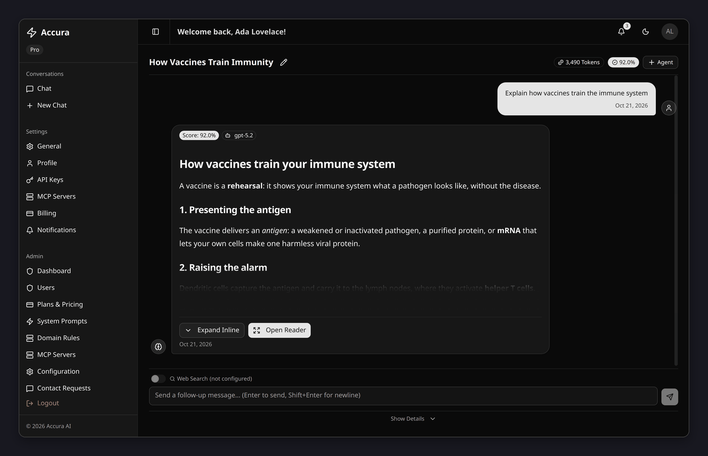
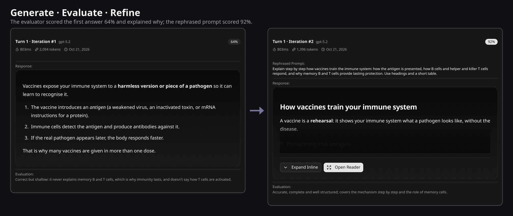
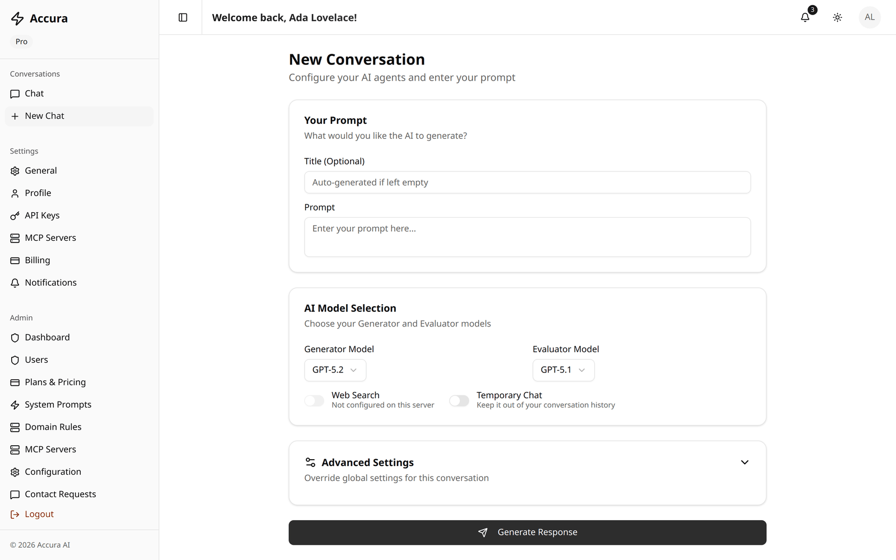
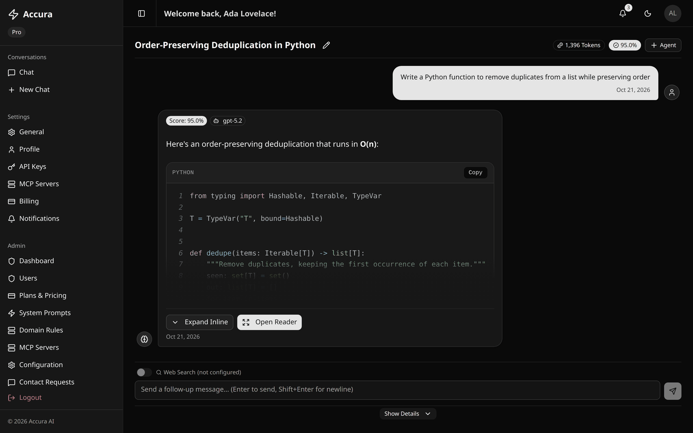
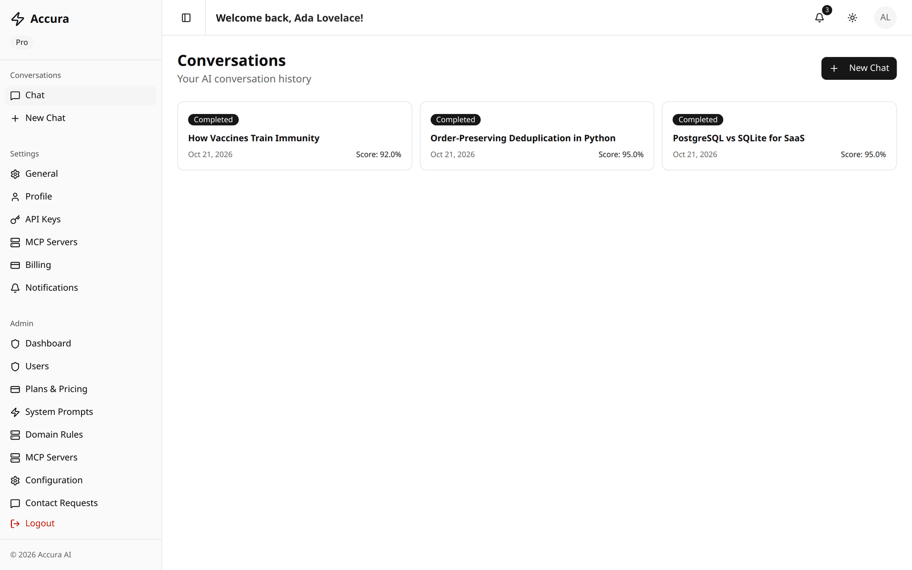
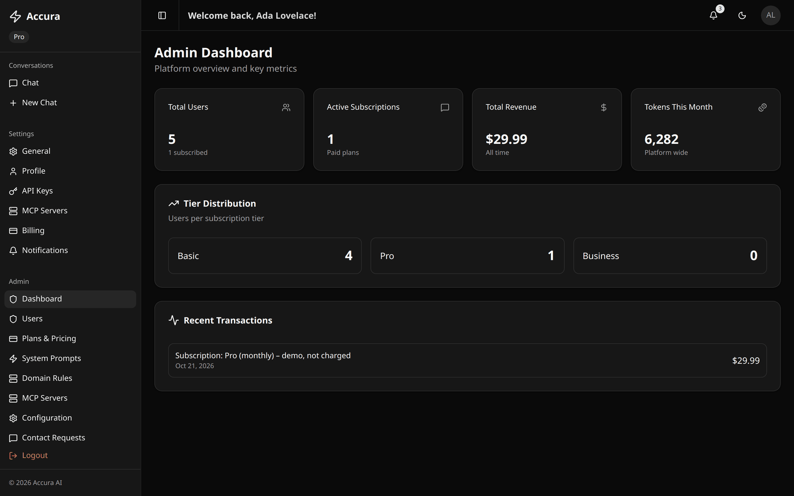
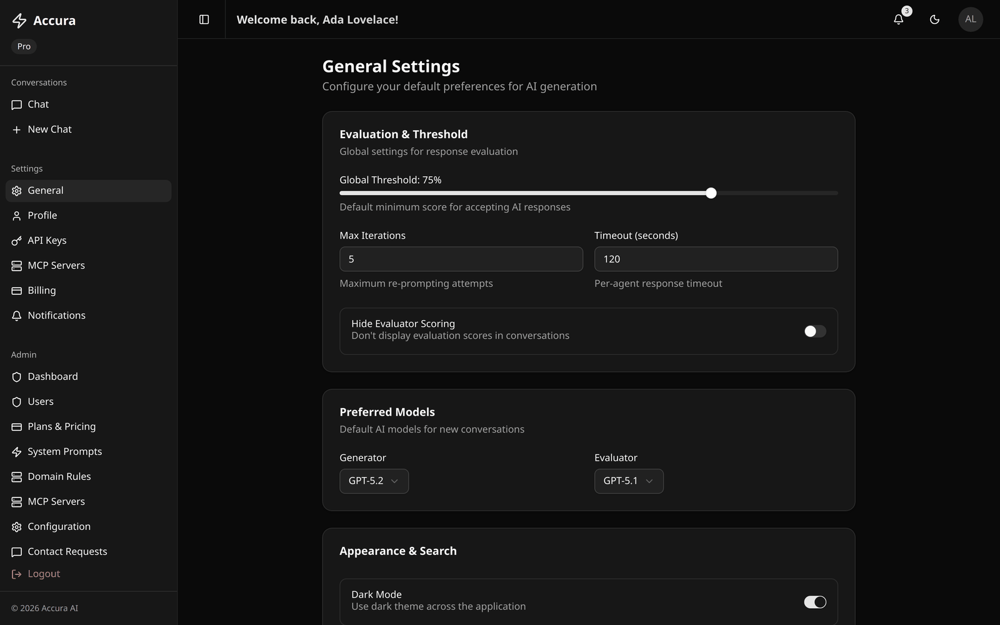
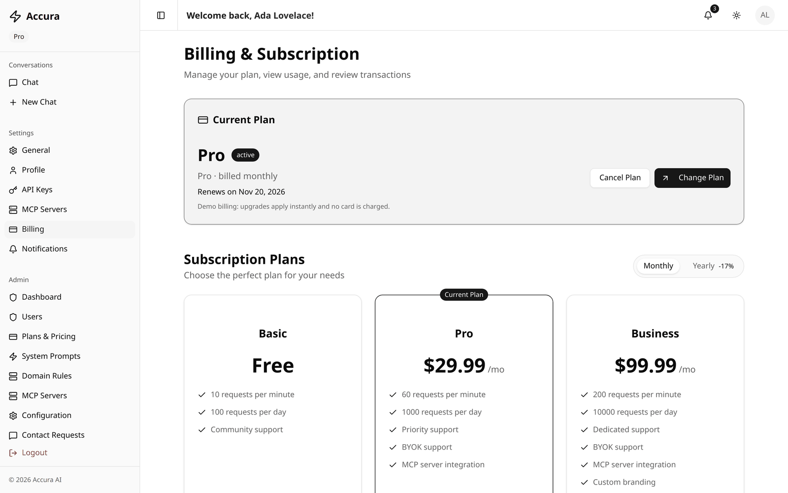
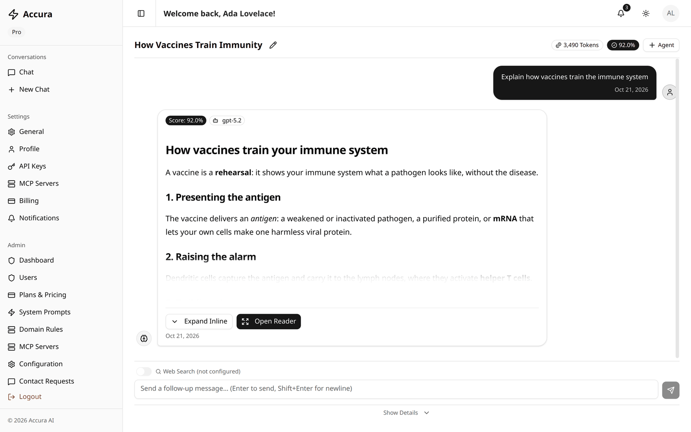
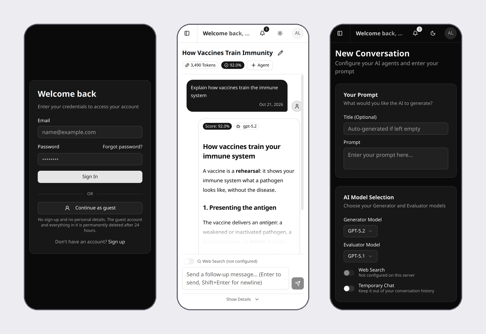

<div align="center">

# Accura

**AI answers that check themselves.** Accura is a self-hosted, multi-agent platform that generates, grades and refines LLM responses until they meet a quality bar.

[](https://github.com/AnnusShahzad/Accura/actions/workflows/ci.yml)


[](https://render.com/deploy?repo=https://github.com/AnnusShahzad/Accura)

[Features](#features) · [Screenshots](#screenshots) · [Quick start](#quick-start-local-development) · [Deploy for free](#free-tier-deployment-render) · [Contributing](CONTRIBUTING.md)



</div>

## Why Accura?

A single LLM call gives you whatever the model produced on the first try. Accura puts a second model in charge of checking it: every answer is **scored by an evaluator**, and answers below your bar are **rewritten from the evaluator's feedback** before you ever see them. You see every attempt, its score and the reason it was rejected.

- **Self-checking answers.** Generate, evaluate, refine, with your own threshold and iteration limit.
- **Multi-agent.** Several generators answer the same prompt in parallel, and the best one wins.
- **Bring your own key.** OpenAI, Anthropic, Google, DeepSeek, or any OpenAI-compatible endpoint (OpenRouter, Groq, vLLM, Ollama).
- **Tools over MCP.** Connect Model Context Protocol servers (Streamable HTTP or SSE) and the model can call their tools.
- **A complete app.** Accounts, guest sessions, plans and billing (Stripe or demo mode), an admin panel, notifications, and light and dark themes that work on phones.
- **Free to host.** One Docker image, one click on Render's free tier.

## Results

Measured over 400+ test prompts, against single-pass answers from GPT-OSS 120B / 20B:

| Metric | Improvement |
|:--|:--|
| Answer accuracy | **~22% higher** |
| Hallucination rate | **~45% lower** |
| Inference cost (BYOK) | **~40% lower** |
| Docker self-host install | **< 8 minutes** |

## How it works



```
 prompt ──▶ Generator agent(s) ──▶ Evaluator agent ──▶ score ≥ threshold? ──yes──▶ answer
                 ▲                                            │
                 └──────── rephrase prompt & regenerate ◀── no (up to N iterations)
```

## What It Does

Accura implements a generate-evaluate-refine loop for AI responses:

1. **Generate** – A generator model answers the prompt, optionally with Google web search results and tools from connected MCP servers, and with the earlier turns of the conversation as context.
2. **Evaluate** – An evaluator model scores the answer from 0–100 against the prompt.
3. **Refine** – Below the threshold, a rephrased prompt is generated from the evaluator's feedback and the loop runs again, until the threshold or the iteration limit is reached.

Several generator agents can work on the same conversation (the best answer wins), and more can be added mid-chat to produce alternatives.

## Screenshots

<table>
  <tr>
    <td width="50%"><br><sub><b>Landing page</b></sub></td>
    <td width="50%"><br><sub><b>New chat</b>: pick generator and evaluator models</sub></td>
  </tr>
  <tr>
    <td><br><sub><b>Code answers</b> with syntax highlighting (Markdown, tables and math render too)</sub></td>
    <td><br><sub><b>Conversations</b> with status and score at a glance</sub></td>
  </tr>
  <tr>
    <td><br><sub><b>Admin dashboard</b></sub></td>
    <td><br><sub><b>Settings</b>: thresholds, iterations, preferred models</sub></td>
  </tr>
  <tr>
    <td><br><sub><b>Plans and billing</b> (Stripe or demo mode)</sub></td>
    <td><br><sub><b>Light mode</b></sub></td>
  </tr>
</table>



<p align="center"><sub>Works on phones too: sign-in with one-click guest access, a scored answer, and a new chat.</sub></p>

## Tech Stack

**Backend** – Sanic, Piccolo ORM (SQLite for development, PostgreSQL for production), JWT auth with bcrypt, OpenAI-compatible client for every provider, optional Redis for rate limiting, SMTP email with Jinja2 templates.

**Frontend** – Next.js 16 (App Router), React 19, shadcn/ui, TanStack Query, Zustand.

## Project Structure

```
accura/
├── backend/
│   ├── models/          # Database tables (User, Subscription, Conversation, ...)
│   ├── routes/          # API endpoints grouped by feature
│   ├── services/        # Orchestrator, generator, evaluator, MCP client, billing ...
│   ├── middleware/      # Auth, rate limiting
│   ├── schemas/         # Pydantic request validation
│   ├── utils/           # Email, crypto, webhooks, schema bootstrap
│   ├── scripts/         # create_admin, delete_user, test_smtp, smoke_test
│   └── tests/           # pytest suite
├── frontend/
│   └── src/             # app/ (routes), components/, hooks/, lib/, stores/, types/
└── scripts/             # Cross-platform helpers used by the root npm scripts
```

## Quick Start (local development)

Prerequisites: Python 3.11+, Node.js 20+. Docker is optional.

```bash
npm install                 # frontend + root tooling
npm run setup:backend       # creates backend/.venv and installs requirements

cp backend/.env.example backend/.env
cp frontend/.env.example frontend/.env.local   # optional: defaults proxy /api/v1 to localhost:8000
```

Edit `backend/.env` and set at least:

```env
JWT_SECRET=<output of: openssl rand -hex 32>
ENCRYPTION_KEY=<output of: python -c "from cryptography.fernet import Fernet; print(Fernet.generate_key().decode())">
OPENAI_API_KEY=<platform key>   # optional: users can also bring their own keys
```

The default database is a local SQLite file, so nothing else is required. Then:

```bash
npm run dev                 # backend on :8000, frontend on :3000
```

Create the first administrator (registration requires an emailed OTP, and admin rights can only be granted by an admin):

```bash
cd backend
.venv/bin/python scripts/create_admin.py you@example.com --password 'S3cure!Pass'
```

Without SMTP configured, verification codes and reset links are printed to the backend log when `APP_DEBUG=true`. Alternatively set `ADMIN_EMAIL`/`ADMIN_PASSWORD` and the admin is created on startup.

### Root scripts

| Script | What it does |
|:--|:--|
| `npm run dev` | Backend and frontend together |
| `npm run dev:backend` / `dev:frontend` | One side only |
| `npm run setup` | Install frontend deps and create the backend virtualenv |
| `npm run build` | Production build of the frontend |
| `npm run lint` | Lint the frontend |
| `npm test` | Backend test suite |
| `npm run dev:infra` / `stop:infra` | Start / stop PostgreSQL and Redis in Docker |

## Free-tier deployment (Render)

[`DEPLOYMENT.md`](DEPLOYMENT.md) puts Accura online for free on Render alone: the frontend and API run as one web service from the root [`Dockerfile`](Dockerfile), with a free PostgreSQL database, set up in one click via [`render.yaml`](render.yaml). It's configured as a public demo, with registration closed and guest sessions that are deleted automatically.

## Docker (self-hosted)

```bash
cd backend
cp .env.example .env        # set JWT_SECRET, ENCRYPTION_KEY, DB_PASSWORD, SMTP_*, keys
docker compose up -d        # PostgreSQL + Redis + backend on :8000
docker compose exec backend python scripts/create_admin.py you@example.com
```

For production, add the override that stops publishing the database and Redis ports and runs the code baked into the image:

```bash
docker compose -f docker-compose.yml -f docker-compose.prod.yml up -d
```

The frontend is a standard Next.js app: `npm run build && npm run start` in `frontend/` (set `NEXT_PUBLIC_API_URL` at build time).

With `APP_ENV=production` the backend refuses to start if `JWT_SECRET` is a placeholder or `ENCRYPTION_KEY` is missing.

## Configuration

Settings are layered, later layers winning:

1. `backend/config.yaml` – defaults
2. Environment variables / `backend/.env` – see `backend/.env.example` for every supported variable
3. **Admin → Configuration** – runtime overrides keyed by dotted config path (e.g. `evaluation.global_threshold`), applied immediately without a restart
4. Per-user settings and per-conversation overrides for threshold, iterations and timeout

Most important variables:

| Variable | Purpose |
|:--|:--|
| `DB_ENGINE` | `sqlite` (default) or `postgres`; `DB_HOST`, `DB_PORT`, `DB_NAME`, `DB_USER`, `DB_PASSWORD` for Postgres |
| `JWT_SECRET`, `ENCRYPTION_KEY` | Token signing and at-rest encryption of stored API keys (required) |
| `OPENAI_API_KEY`, `DEEPSEEK_API_KEY`, `ANTHROPIC_API_KEY`, `GOOGLE_AI_API_KEY` | Platform keys per provider |
| `CUSTOM_AI_API_KEY`, `CUSTOM_AI_BASE_URL`, `OPENAI_BASE_URL` | Any OpenAI-compatible endpoint (vLLM, Ollama, OpenRouter, NVIDIA NIM, ...) |
| `DEFAULT_GENERATOR_MODEL`, `DEFAULT_EVALUATOR_MODEL`, `DEFAULT_REPROMPT_MODEL` | Models used when none is chosen |
| `SMTP_HOST`, `SMTP_PORT`, `SMTP_USER`, `SMTP_PASSWORD`, `SMTP_FROM_EMAIL` | OTP codes, password reset, email notifications |
| `GOOGLE_API_KEY`, `GOOGLE_CSE_ID` | Web search (search is skipped when unset) |
| `STRIPE_SECRET_KEY`, `STRIPE_WEBHOOK_SECRET`, `STRIPE_PRICE_PRO_MONTHLY`, `STRIPE_PRICE_PRO_YEARLY` | Real payments; leave empty for demo billing |
| `REDIS_URL` | Shared rate limiting across workers (in-memory when unset) |
| `APP_CORS_ORIGINS` | Comma-separated allowed origins |
| `DATABASE_URL`, `PORT` | Platform-style database URL and listening port (take precedence) |
| `REGISTRATION_ENABLED`, `GUEST_ENABLED`, `GUEST_TTL_HOURS` | Sign-up switch and throwaway guest accounts |
| `ADMIN_EMAIL`, `ADMIN_PASSWORD` | Admin account created/updated on startup (for hosts without a shell) |
| `ALLOW_PRIVATE_URLS` | Set `false` on public servers: user-supplied URLs may not target private networks |
| `DEFAULT_AI_PROVIDER` | Provider used when none is chosen (e.g. `custom` for an OpenRouter-only setup) |

## Features

### AI orchestration
- Generate → evaluate → rephrase loop with configurable threshold, iteration limit and per-agent timeout
- Multiple generator agents in parallel; agents can be added mid-chat for alternative answers
- Follow-up messages carry the conversation history to both generator and evaluator
- Failed runs (missing key, provider error, timeout) are reported in the chat with a Retry button
- Token usage recorded per iteration and per conversation; conversations are auto-titled

### Providers and BYOK
OpenAI, DeepSeek, Anthropic and Google AI (through their OpenAI-compatible endpoints) plus any custom OpenAI-compatible endpoint. Users can store their own keys, encrypted at rest with Fernet; a user's key takes precedence over the platform key for that provider.

### MCP tools
Users on Pro/Business, and admins for everyone, can connect MCP servers over **Streamable HTTP** or legacy **SSE**. Tools are discovered at the start of each run and offered to the model as function calls; unreachable servers are skipped. ("stdio" servers cannot be reached by a hosted backend.)

### Subscriptions and billing
- Basic / Pro / Business plans with per-plan rate limits, editable by admins
- **Stripe mode** (`STRIPE_SECRET_KEY` set): upgrades go through Stripe Checkout; the signed webhook at `/api/v1/billing/webhook` activates, renews, marks past-due and cancels subscriptions
- **Demo mode** (no Stripe key): upgrades apply instantly, transactions are marked "demo, not charged", and a background job rolls billing periods over
- Business plans go through the contact form

### Web search
Google Programmable Search with admin-managed domain whitelist/blacklist (subdomains included); results are restricted to recent months when the prompt asks for current information.

### Notifications
In-app, email, Slack and Teams (incoming webhooks), per user.

## API Overview

All endpoints are under `/api/v1/`, authenticated with `Authorization: Bearer <access token>` unless public. Interactive docs are served at `/docs` by the backend.

- **auth** – register, OTP verification, login, refresh, password reset, email change
- **user** – profile
- **chat** – conversations, follow-up messages, extra agents, retry, iterations, tokens
- **settings** – thresholds, preferred models, notification channels
- **api-keys** – BYOK key management
- **mcp-servers** – MCP server configuration and connection test
- **billing** – plans (public), subscribe, cancel, subscription, transactions, token usage, Stripe webhook
- **notifications** – list, unread count, mark read, delete
- **contact** – public contact form
- **admin** – dashboard, users, plans, system prompts, domain rules, global MCP servers, configuration overrides, contact requests

## Development

### Tests

```bash
npm test                                   # or: cd backend && .venv/bin/python -m pytest
```

The suite uses a throwaway SQLite database and fake AI/MCP/HTTP backends, so it needs no network or keys. To run it against PostgreSQL:

```bash
TEST_DB_ENGINE=postgres DB_HOST=localhost DB_PORT=5432 DB_NAME=accura_test \
  DB_USER=accura DB_PASSWORD=... npm test
```

`backend/scripts/smoke_test.py` exercises a running server over HTTP.

### Database schema

Tables are created on startup and columns added since a database was first created are back-filled automatically (`backend/utils/db_schema.py`), for both SQLite and PostgreSQL. No manual migration step is needed for additive changes.

### Utilities (`backend/scripts/`)

- `create_admin.py` – create an admin or promote an existing user
- `delete_user.py` – permanently delete a user and everything they own
- `test_smtp.py` – send a test email with the configured SMTP settings
- `smoke_test.py` – HTTP smoke test against a running backend

## License

See [LICENSE](LICENSE) for details.
